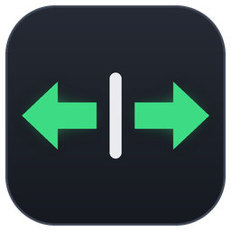

<p align="center"></p>

<h1 align="center">StalkSync</h1>

Petit utilitaire Windows qui fait fonctionner le commodo de clignotants (ex. Moza Multi-function Stalks)
comme sur un vrai véhicule dans Euro Truck Simulator 2, American Truck Simulator, BeamNG.drive,
Assetto Corsa, Assetto Corsa Competizione… et n'importe quel jeu qui allume ses clignotants avec une touche.

Ces jeux traitent le clignotant comme une bascule : un appui l'allume, un autre l'éteint. Un commodo qui reste
en position ne renvoie pas de second appui en revenant au centre, et le jeu finit désynchronisé.
StalkSync suit la position du commodo, retient l'état du clignotant dans le jeu et n'envoie la touche
du jeu que quand les deux diffèrent.

Testé avec le commodo Moza Multi-function Stalks dans ETS2.

## Fonctions

- **Synchronisation** : commodo à gauche = clignotant gauche, au centre = éteint.
- **Clignotements confort** : un appui bref donne 3 clignotements (nombre et durée réglables).
- **Trois types de commodo** : maintenu (reste en position), impulsion (revient au centre), ou un bouton
  par position (Moza : une impulsion en arrivant à gauche, au centre ou à droite).
- **Plusieurs jeux** : chacun a ses touches, et StalkSync reconnaît le jeu au premier plan.
- **Aucune touche envoyée** si la fenêtre active n'est pas un jeu de la liste : StalkSync attend que le jeu repasse au premier plan.

## Jeux

| Jeu | Touches par défaut | Remarque |
|---|---|---|
| Euro Truck Simulator 2 / American Truck Simulator | `[` et `]` | Désactiver l'extinction automatique des clignotants. |
| BeamNG.drive | `,` et `.` | |
| Assetto Corsa | à définir | Clignotants ajoutés par Custom Shaders Patch : leur assigner une touche dans les commandes. |
| Assetto Corsa Competizione | `Alt + ←` et `Alt + →` | |

Pour un autre jeu : lancer le jeu, cliquer **Ajouter…** dans la carte *Jeux*, choisir sa fenêtre, puis
définir les touches de clignotant réglées dans ce jeu.

## Installation

1. Télécharger `StalkSync.exe` depuis la page *Releases* et le lancer (aucune installation).
2. Dans StalkSync, cliquer **Détecter** pour la gauche puis pousser le commodo à fond à gauche ; idem à droite.
3. Choisir le type de commodo. Pour le type **un bouton par position** (commodo Moza), mettre le commodo
   à fond d'un côté, cliquer **Détecter** sur la ligne *Centre* puis le ramener au centre.
4. Dans la carte *Jeux*, choisir son jeu et vérifier que les touches affichées sont celles des
   clignotants dans les options du jeu. Sinon, cliquer **Définir** et appuyer sur la bonne touche
   (Ctrl, Alt et Maj sont acceptés).
5. Dans le jeu, **retirer le commodo des réglages de clignotants** (sinon le jeu reçoit la commande deux fois).

Si le jeu est lancé en administrateur, StalkSync doit l'être aussi, sinon Windows bloque les touches.

## Réglage conseillé dans le jeu

Désactiver l'extinction automatique des clignotants si le jeu en a une. StalkSync ne voit pas
ce que fait le jeu : si le jeu coupe le clignotant tout seul, StalkSync le croit encore allumé et
appuiera à contretemps au retour du commodo au centre.

## Développement

```
dotnet test tests/StalkSync.Tests
dotnet publish src/StalkSync -c Release -r win-x64 --self-contained -p:PublishSingleFile=true -p:EnableCompressionInSingleFile=true -p:IncludeNativeLibrariesForSelfExtract=true -o publish
```

- `src/StalkSync.Core` : logique de décision, sans dépendance Windows, testée.
- `src/StalkSync` : application WinForms (.NET 8) — DirectInput, `SendInput`.
- Réglages enregistrés dans `%AppData%\StalkSync\config.json`.
